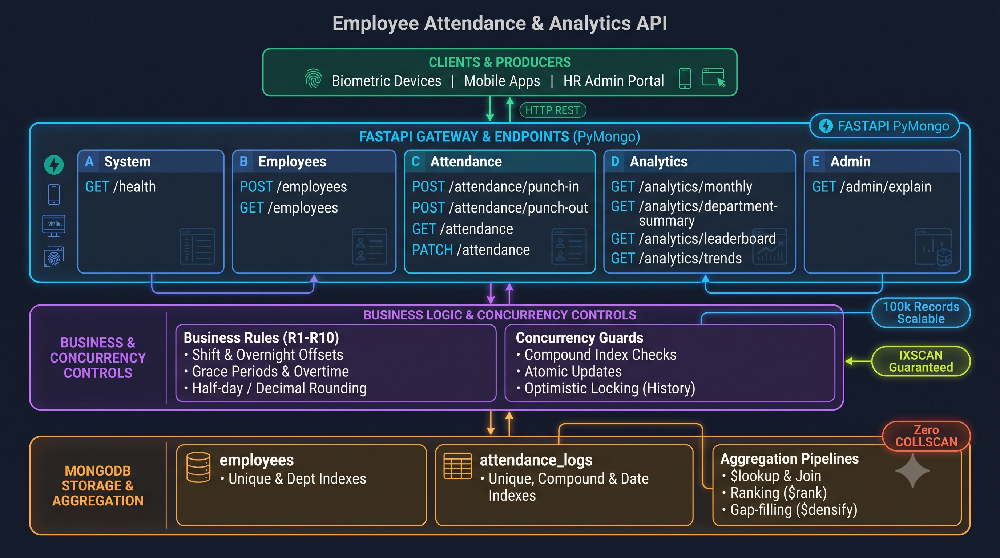

# Employee Attendance & Analytics API

This is a small employee attendance and analytics service built with FastAPI and MongoDB.

## Tech Stack

- **Framework:** FastAPI (Python 3.11+)
- **Server:** Uvicorn (ASGI)
- **Database:** MongoDB 7.0 (via PyMongo with timezone-aware UTC datetimes)
- **Validation:** Pydantic v2 (strict type constraints for epoch milliseconds and IST strings)
- **Environment:** python-dotenv

## Architecture

The high-level design diagram is in the `img/` directory:



## Requirements

- Python 3.11+
- MongoDB 6.0+ (tested on MongoDB 7.0)

## How to Run

1. Create and activate a virtual environment:
   ```bash
   python -m venv .venv
   source .venv/bin/activate
   pip install -r requirements.txt
   ```
2. Set configuration in environment variables or in a local `.env` file (real environment variables win):
   ```bash
   export MONGO_URI="mongodb://localhost:27017"
   export MONGO_DB="attendance_db"
   ```
3. Start the application:
   ```bash
   uvicorn app.main:app --port 8000
   ```
Database indexes are created automatically at startup. The `/health` endpoint returns `{"status": "ok"}` with status 200 when MongoDB answers.

## Endpoints

- `GET /health`: Readiness probe that checks MongoDB connection.
- `POST /employees`: Create an employee record with a unique `emp_code`.
- `GET /employees`: List employees filtered by department with pagination.
- `POST /attendance/punch-in`: Record a daily punch-in with grace and late checks.
- `POST /attendance/punch-out`: Record punch-out and compute work hours, overtime, and half day.
- `GET /attendance`: List attendance logs with filter and pagination.
- `PATCH /attendance/{emp_code}/{date}`: Regularize a log and append an audit entry.
- `GET /analytics/employees/{emp_code}/monthly`: Monthly summary of attendance for one employee.
- `GET /analytics/departments/summary`: Department monthly metrics including zero-log headcount.
- `GET /analytics/leaderboard/late`: Late employee leaderboard with competition ranking.
- `GET /analytics/departments/{department}/trend`: Daily attendance trend with 7-day moving average.
- `GET /admin/explain/{endpoint}`: MongoDB executionStats explain output for query plans.

## Assumptions

1. Where the contract is unclear, I check 404 first, then 409, and then 422.
2. For the trend endpoint, an invalid date range returns 422 before an unknown department returns 404.
3. The 7-day moving average uses the rounded (4 decimals, half-up) daily rates shown in the response, then rounds the mean half-up to 4 decimals. Days with a null rate stay inside the 7-row window, but I skip them when computing the mean.
4. The trend pipeline inserts one seed document dated one day before the query start date so that `$densify` always has an input document, and removes it with `$match` afterwards.
5. The department summary pipeline passes an explicit index hint so MongoDB uses an index scan on employees instead of a collection scan.
6. All reported numbers use exact arithmetic half-up rounding (Decimal or integer math), never built-in Python `round()` or Mongo `$round` on reported values. The only place `$round` is used is converting `work_hours * 100` to integer cents.

## What is Missing

Nothing is missing.
